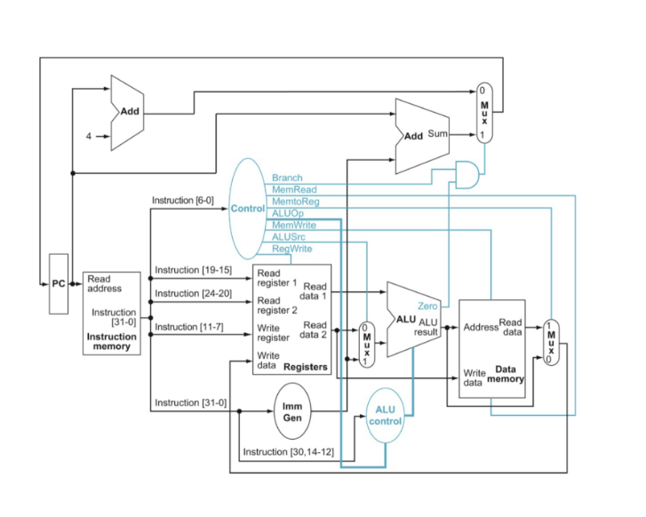
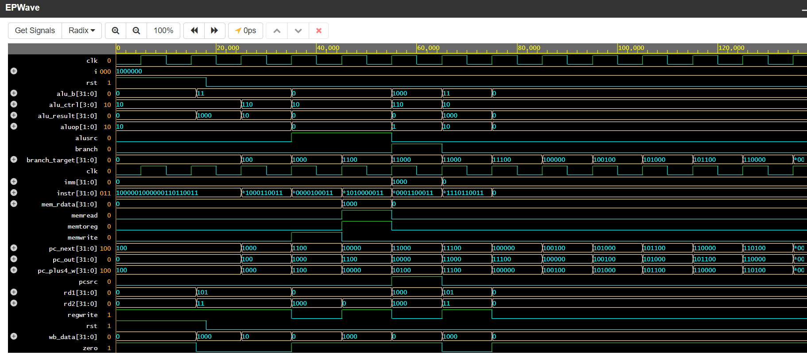

# Single-Cycle RISC-V Processor (Verilog)

A single-cycle 32-bit RISC-V processor written in Verilog and simulated on EDA Playground.

**Supported instructions:** `lw`, `sw`, `add`, `sub`, `and`, `or`, `beq`

## Datapath



## Repository layout

```
rtl/riscv_single_cycle.v   # all modules + top level (riscv_single_cycle_top)
tb/tb.v                    # testbench with a small test program
docs/datapath.png          # block diagram
docs/waveform.png          # EPWave simulation output
```

## Modules

| Module | Role |
|---|---|
| `program_counter`, `pc_plus4` | PC register and PC + 4 |
| `instruction_mem` | 64-word instruction memory (word-addressed) |
| `register_file` | 32 x 32-bit registers, x0 hardwired to 0 |
| `Imm_gen` | Immediate generator for lw / sw / beq |
| `control_unit`, `ALU_control` | Main control and ALU control |
| `ALU_unit` | AND, OR, ADD, SUB + zero flag |
| `data_mem` | 64-word data memory |
| `mux1` / `mux2` / `mux3` | PC select, ALU source, write-back select |
| `and_logic`, `adder` | Branch decision and branch-target adder |

## Test program

| Addr | Machine code | Instruction | Expected |
|---|---|---|---|
| 0 | `0x002081B3` | `add x3, x1, x2` | x3 = 8 |
| 1 | `0x40208233` | `sub x4, x1, x2` | x4 = 2 |
| 2 | `0x00302023` | `sw x3, 0(x0)` | mem[0] = 8 |
| 3 | `0x00002283` | `lw x5, 0(x0)` | x5 = 8 |
| 4 | `0x00518463` | `beq x3, x5, +8` | taken |
| 5 | `0x40208333` | `sub x6, x1, x2` | skipped, x6 = 0 |
| 6 | `0x002083B3` | `add x7, x1, x2` | x7 = 8 |

The testbench preloads x1 = 5 and x2 = 3, then prints the final register and memory values next to the expected ones.

## Simulation waveform



## Running

**EDA Playground:** paste `rtl/riscv_single_cycle.v` into the design pane and `tb/tb.v` into the testbench pane, choose Icarus Verilog, and enable EPWave.

**Locally (Icarus Verilog):**
```
iverilog -o sim rtl/riscv_single_cycle.v tb/tb.v
vvp sim
gtkwave dump.vcd
```
